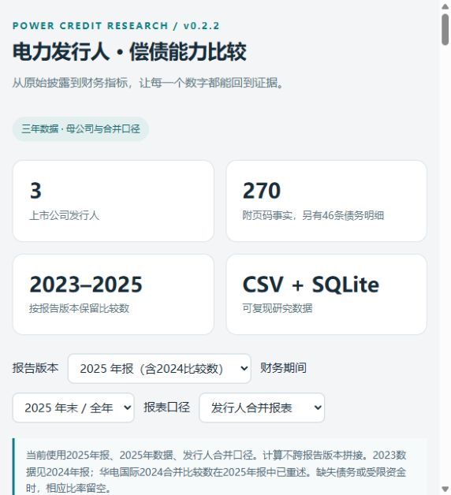

# 电力行业发债主体偿债能力与信用风险比较

An evidence-linked credit research dataset for listed Chinese power issuers.

**状态：v0.2.2，新增华能母公司条件性收现桥接。** 覆盖三家发行人的2023–2025年核心报表数据，保留2024、2025两个年报版本。包含270条财务事实、46条债务分类记录和6份公开年报来源；计算按发行人、期间、报表口径和报告版本隔离。尚未形成统一合并范围的三年完整序列。




## 研究问题

在持续资本开支背景下，发行人的经营现金流、受限资金与债务到期结构，如何共同影响偿债能力？会计权益列报的永续债与合并范围变化，又会怎样影响同行比较？

## 快速开始

运行核心计算只需要 Python 3.12 或以上版本，无第三方运行依赖：

```bash
python -m unittest discover -s tests -v
python -m power_credit.build
```

随后双击 `dashboard/index.html`，可以离线查看发行人比较、母公司现金来源、版本差异、债务明细与证据。切换报告版本、财务期间与报表口径；2023年数据在2024年报版本中。也可以运行：

```bash
python -m http.server 8765 --bind 127.0.0.1
```

并访问 `http://127.0.0.1:8765/dashboard/index.html`。

如需核对原始 PDF，运行 `python scripts/download_sources.py`；文本提取和原文数值检查工具另需安装 `pypdf`，再运行 `python scripts/extract_pdf_text.py` 或 `python scripts/audit_pdf_evidence.py`。原始文件与提取全文留在本地，不进入版本控制。

本次已核对6份文件的哈希与页数，453个数值／页码引用检查通过；标签、年份列和经济含义仍须结合原表核验，数值出现检查不能替代人工复核。

## 数据设计

| 文件 | 内容 |
|---|---|
| `data/issuers.csv` | 发行人全称、代码与样本说明 |
| `data/sources.csv` | 公开年报链接、披露日期与核查日期 |
| `data/source_checksums.csv` | 本次核查的原始文件哈希与 PDF 页数 |
| `data/facts.csv` | 原始数值、币种、单位、期间、合并／母公司口径、报告版本、页码与核验状态 |
| `data/debt_breakdown.csv` | 46条债务类别与期限原表记录；保留空白与披露精度 |
| `data/cash_bridge_inputs.csv` | 3条华能母公司应收股利余额及联合营宣告分红证据，新增数据待用户复核 |
| `data/dividend_receivables.csv` | 27行应收股利及重要超1年子表原始明细，保留空白 |
| `data/processed/cash_bridge.json` | 条件性桥接、假设、残差与已列重要账龄项目占比 |
| `data/review_log.csv` | 9条用户反馈记录，含字段、日期、文件哈希及两种PDF编排的页码映射 |
| `data/investment_income_evidence.csv` | 5项华能母公司收益／收现证据，分开记录权责发生制与现金流量 |
| `data/evidence_issues.csv` | 原文矛盾、精确差额、来源及待核实状态 |
| `data/processed/reconciliation.csv` | 64项跨报告版本对照，包括9项有差额的字段 |
| `data/processed/comparison.csv` | 衍生指标，金额统一为人民币千元 |
| `data/processed/credit.sqlite` | 本地生成的SQLite库，含事实、债务明细、版本对照与问题登记，不提交版本控制 |
| `data/processed/research.json` | 看板使用的结构化数据 |
| `dashboard/index.html` | 不依赖外部脚本的交互看板 |

所有事实保持年报原单位；计算时使用Decimal统一成人民币千元。看板金额转换成亿元。缺失值不填零，缺少分母的比率不计算。事实主键包括 `issuer_id + period_end + scope + report_vintage + metric`，不同版本不覆盖、不自动拼接。

`agent_verified` 表示 AI 已依据原文核对，**不代表你已经独立复核**；你的复核完成后可改为 `user_verified`，并必须有对应 `review_log.csv`。当前仅5条主事实、3项收益构成、1项短债矛盾完成用户复核；未将该状态扩展至未确认字段。原文一致与问题已解决分开记录。

## 初版指标

- 资产负债率、流动比率。
- 货币资金及扣已披露受限资金后现金对一年内到期有息债务的覆盖。
- 全年经营现金流对期末有息债务的覆盖、短期债务占比。
- 经营现金流减购建长期资产支付现金的代理指标。
- 将权益列报永续债 100% 重分类为负债的杠杆敏感性情景。
- 经营现金流下降 20%、购建支出增加 10% 的假设情景。

公式、定义与限制见 [指标口径](docs/methodology.md)。上述指标不生成综合信用排名，也不将情景现金流直接解释为偿债缺口。

## 当前数据的关键口径

1. 样本是三个上市公司发行人，分别保存合并与母公司口径；母公司指上市发行人自身，不使用控股集团财务数据替代。
2. 2025版本含2025本期与2024比较数；2024版本含2024本期与2023比较数。华电国际2024合并比较数、大唐国际2023合并比较数已重述。此数据集不能直接作为历史时点回测输入。
3. 有息债务和一年内到期债务采用债券章节相应口径披露值，金额精度不同。2024年末债务明细仅录入华能和华电；2023年末期限结构、大唐2024年末明细仍缺。
4. 华能国际另有境外资金汇回限制。其与受限货币资金是否重叠尚未确认，因此不直接相加扣减。
5. 华电国际旧版2024年末债务1,178.35亿元与新版期初1,423.27亿元相差244.92亿元。期初值另存作核查线索，不与旧版报表混用。母公司受限资金仍缺，调整现金短债比留空。
6. 华能2025合并短债分类相加1,048.69亿元，与披露合计1,047.88亿元相差0.81亿元；非银行贷款行也有同一差额。保留原数、登记两项检查例外，覆盖率使用披露合计。用户已确认短债列矛盾属实；问题仍待核实。超容差例外只有来源及精确差额匹配时才放行。
7. 华能母公司收益附注成本法72.63亿元、权益法8.55亿元、委托贷款2.92亿元合计84.09亿元，不能直接拆分86.20亿元现金收现；两种计量口径差额2.1066亿元未归因。取得投资收益收到的现金不能直接认定为子公司股利；财务公司存款不自动判定受限或无条件可用。负经营现金流不套用现有下降情景。
8. 资料核查日期为2026-10-11，财务快照为2025年末。2026年半年报、可用授信、评级依据、个券估值与后续融资事件尚未纳入。

## 下一阶段

已形成 [初步比较研究札记](docs/research_note.md)。已新增[华能母公司收现桥接初稿](docs/cash_bridge_huaneng.md)：联合营宣告分红4.65亿元，应收股利净减少6.42亿元；简化假设推算86.62亿元，实际86.20亿元，残差-0.4187亿元未解释。该推算尚未验证，不改写已披露现金流或形成新的偿债覆盖结论。

下一步按 [协作与复核日志](docs/collaboration.md) 延续核验，补充债务口径桥接、评级、授信与再融资资料，再形成完整主体一页纸和信用报告。阶段边界见 [实施路线](docs/roadmap.md)。

## 公开来源

- [华能国际 2025 年度报告（港交所披露）](https://www1.hkexnews.hk/listedco/listconews/sehk/2026/0325/2026032500011_c.pdf)
- [华电国际 2025 年年度报告（巨潮资讯）](https://static.cninfo.com.cn/finalpage/2026-03-27/1225039299.PDF)
- [大唐国际 2025 年年度报告（港交所披露）](https://www.hkexnews.hk/listedco/listconews/sehk/2026/0327/2026032703594_c.pdf)
- [华能国际2024年年度报告](https://www.hkexnews.hk/listedco/listconews/sehk/2025/0325/2025032501669_c.pdf)
- [华电国际2024年年度报告](https://static.cninfo.com.cn/finalpage/2025-03-28/1222927023.PDF)
- [大唐国际2024年年度报告](https://www.hkexnews.hk/listedco/listconews/sehk/2025/0325/2025032501723_c.pdf)

仓库只保留研究代码、整理的财务事实、计算结果和公开来源链接；原始年报全文不随仓库分发。

## GitHub 发布

公开仓库：[yang2267251737-cmd/power-credit-research](https://github.com/yang2267251737-cmd/power-credit-research)。CI 会运行数据验证和财务计算测试。更新方式见 [GitHub 发布说明](docs/github.md)。
